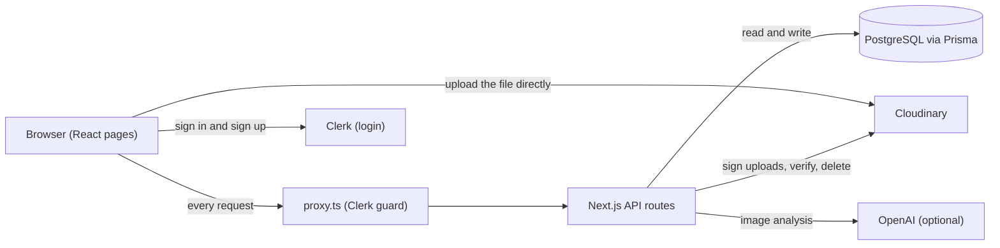
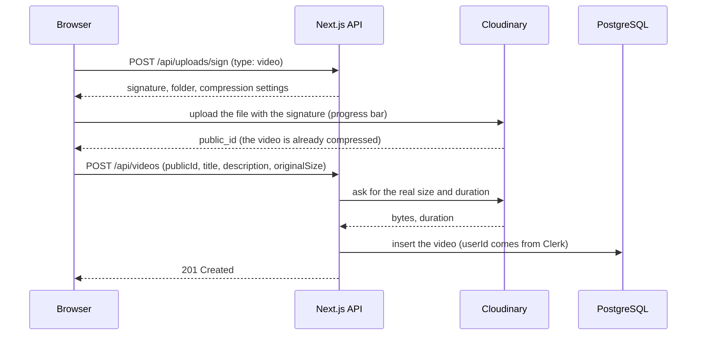

# CloudMedia

A video library with automatic compression, an image resizer for social media, and AI feedback on photos.

Users upload videos straight to Cloudinary, which compresses them. CloudMedia shows how much space each video saved, lets owners edit or delete their videos, and lets everyone search and browse the public gallery.

Built with **Next.js 16, TypeScript, Clerk, Cloudinary, Prisma and PostgreSQL**.

<!-- Add 2-3 screenshots here: the video gallery, the upload page with the progress bar, and the social share page.
     Example:  -->

## Features

**Videos**
- Direct-to-Cloudinary uploads with a progress bar (no file size limit from our server)
- Automatic compression while saving (automatic quality, mp4)
- Gallery with search, pagination (9 per page) and an "All videos / My videos" switch
- Hover preview (a 15-second highlight clip), full player in a pop-up, and one-click download
- Edit title and description, delete a video (removes the file from Cloudinary and the database row)
- "My videos" statistics: video count, space saved, storage used

**Images**
- Social share tool: Instagram square and portrait, Twitter post and header, Facebook cover
- Smart crop keeps the important part of the picture; download the exact size

**AI studio** (optional)
- Upload a photo, ask a question, get an answer from OpenAI
- Daily limit per user (default 5 per 24 hours); the page switches itself off if no API key is set

**Security and quality**
- Clerk login. `proxy.ts` guards pages and API routes, and every route checks `auth()` again
- Owner-only edit and delete (403 for anyone else)
- Every input is validated with zod
- The server asks Cloudinary for the real file size and duration instead of trusting the browser
- 61 automated tests (unit tests and API tests against a real PostgreSQL database)

## Tech stack

| Area | Tools |
| --- | --- |
| Framework | Next.js 16 (App Router), React 19, TypeScript |
| UI | Tailwind CSS 4, DaisyUI 5, lucide-react |
| Data fetching | SWR, axios |
| Auth | Clerk |
| Media | Cloudinary, next-cloudinary |
| Database | PostgreSQL (Neon), Prisma ORM 7 with the `pg` driver adapter |
| Validation | zod |
| AI | OpenAI (optional) |
| Tests | Vitest |

## How it works



### Upload flow

Large files do not pass through our server. The browser gets a short-lived signature from the server and uploads straight to Cloudinary. After that, the server checks the file with Cloudinary before saving a row.



Why this design:
- **No size limit from our server.** Next.js limits request bodies when a proxy is present, and serverless hosts such as Vercel limit them too. Direct upload avoids both.
- **The secret stays on the server.** The browser only gets a signature, never the API secret.
- **The browser cannot cheat.** The folder and the compression settings are part of the signature, and the file must sit in the user's own folder (`cloudmedia/<userId>/videos`).

## Database

Two tables, managed with Prisma migrations (`prisma/migrations`).

**`videos`**

| Column | Type | Notes |
| --- | --- | --- |
| `id` | text, primary key | cuid |
| `userId` | text | Clerk user id of the owner |
| `title` | text | 1 to 100 characters |
| `description` | text, nullable | up to 300 characters |
| `publicId` | text, unique | Cloudinary id, used to build thumbnail, preview and video URLs |
| `originalSize` | integer | bytes before compression |
| `compressedSize` | integer | bytes after compression (from Cloudinary) |
| `duration` | double | seconds (from Cloudinary) |
| `createdAt`, `updatedAt` | timestamp | |

Indexes: `(userId, createdAt)` for "my videos", `(createdAt)` for the gallery, unique `publicId`.

**`ai_generations`**: one row per AI analysis (`id`, `userId`, `createdAt`). Counting the rows from the last 24 hours gives the daily limit.

## API

| Method | Path | Who | What it does |
| --- | --- | --- | --- |
| GET | `/api/videos` | Everyone (`mine=true` needs login) | List videos. Query: `page`, `pageSize` (max 24), `q`, `mine` |
| POST | `/api/videos` | Logged in | Save an uploaded video after checking it with Cloudinary |
| PATCH | `/api/videos/:id` | Owner | Edit title and description |
| DELETE | `/api/videos/:id` | Owner | Delete from Cloudinary, then from the database |
| GET | `/api/videos/stats` | Logged in | Count, sizes and space saved for my videos |
| POST | `/api/uploads/sign` | Logged in | Create a signed upload for a video or an image |
| GET | `/api/ai-image` | Logged in | Is AI on? Daily limit and how many are left |
| POST | `/api/ai-image` | Logged in | Analyze an image with a prompt |

Every error looks like `{ "error": "message" }`. Status codes: `400` invalid input, `401` not logged in, `403` not the owner, `404` not found, `409` already saved, `429` daily AI limit reached, `502` Cloudinary or AI service failed, `503` AI not set up.

## Project structure

```
app/
  (app)/                 pages with the sidebar layout
    home/                video gallery: search, tabs, pagination, play, edit, delete
    video-upload/        upload form with progress bar
    social-share/        image resizer
    ai-studio/           AI image analysis
  (auth)/                Clerk sign-in and sign-up pages
  api/                   route handlers (see the API table)
  layout.tsx, page.tsx   root layout and landing page
components/              VideoCard, modals, StatsBar, Toast, AI assistant
lib/                     prisma, cloudinary, validation, format, ai, ai-quota, upload...
prisma/                  schema.prisma and migrations
tests/                   API tests
proxy.ts                 route protection (called middleware.ts before Next.js 16)
```

## Getting started

You need Node.js 20.9 or newer, and free accounts at [Clerk](https://clerk.com), [Cloudinary](https://cloudinary.com) and [Neon](https://neon.tech) (or any PostgreSQL database).

```bash
git clone https://github.com/roshan-kunchikorve/Cloudinary-Saas.git
cd Cloudinary-Saas
npm install
```

1. Copy `.env.example` to `.env` and fill in the values:

   | Variable | Where to find it | Required |
   | --- | --- | --- |
   | `NEXT_PUBLIC_CLERK_PUBLISHABLE_KEY`, `CLERK_SECRET_KEY` | Clerk dashboard, API keys | Yes |
   | `NEXT_PUBLIC_CLOUDINARY_CLOUD_NAME`, `CLOUDINARY_API_KEY`, `CLOUDINARY_API_SECRET` | Cloudinary dashboard | Yes |
   | `DATABASE_URL` | Neon connection string | Yes |
   | `DIRECT_URL` | Neon direct (non-pooled) connection string, used for migrations | No |
   | `OPENAI_API_KEY`, `OPENAI_MODEL`, `AI_DAILY_LIMIT` | OpenAI dashboard | No (AI studio switches off without a key) |

2. Create the tables:

   ```bash
   npm run db:deploy
   ```

3. Start the app:

   ```bash
   npm run dev
   ```

   Open http://localhost:3000, create an account, and upload a short video.

## Scripts

| Command | What it does |
| --- | --- |
| `npm run dev` | Start the development server |
| `npm run build` / `npm start` | Production build and server |
| `npm run lint` | ESLint |
| `npm test` | Vitest (unit tests, and API tests when `TEST_DATABASE_URL` is set) |
| `npm run db:migrate` | Create and apply a migration after you change `schema.prisma` (development) |
| `npm run db:deploy` | Apply the existing migrations (production and fresh databases) |

`npm install` also runs `prisma generate`, which creates the typed database client in `lib/generated`.

## Testing

```bash
npm test
```

This runs the unit tests (formatting, validation, ownership rules). The API tests call the real route handlers against a real PostgreSQL database, with Clerk, Cloudinary and OpenAI replaced by fakes. They run when `TEST_DATABASE_URL` is set.

1. Create an **empty** database just for tests. The tests delete every row in it, so never use your real database (the tests refuse to start if the URLs are the same).
2. Create the tables in it. Mac or Linux: `DIRECT_URL="<test url>" npx prisma migrate deploy`. Windows PowerShell: `$env:DIRECT_URL="<test url>"; npx prisma migrate deploy`.
3. Add `TEST_DATABASE_URL=<test url>` to `.env` and run `npm test`.

## Deploying to Vercel

1. Import the repository in Vercel and add the environment variables from `.env.example`.
2. Use Clerk's production keys and add your domain in the Clerk dashboard.
3. Run `npm run db:deploy` once with `DATABASE_URL` (or `DIRECT_URL`) pointing at the production database.

## Design decisions

| Decision | Why |
| --- | --- |
| Signed direct upload to Cloudinary | No file size limit from our server, and the API secret never reaches the browser |
| Server verifies the upload with Cloudinary | Size and duration come from Cloudinary, not from the browser |
| One Cloudinary folder per user | The server can prove a file belongs to the user with a simple prefix check |
| The server decides `isOwner` | The browser never receives `userId` and never decides who may edit |
| Delete from Cloudinary first, then the database | If Cloudinary fails, the row stays and the user can retry. No hidden file that we pay for |
| Offset pagination and `ILIKE` search | Simple and fast enough for this size. See the roadmap for what changes at scale |
| AI usage stored in a table | A daily limit that survives restarts and works on serverless hosting |
| Prisma stable release with the `pg` adapter | A widely used ORM, a typed client, and tracked migrations |

## Known limitations and roadmap

- If the browser uploads a file but closes before saving it, the file stays in Cloudinary. A Cloudinary webhook or a cleanup job can remove such files.
- All videos are public. Private videos need Cloudinary's authenticated delivery.
- Search uses `ILIKE`. For a large library, use PostgreSQL full-text search or a trigram index.
- Compression is applied while saving, so the original file is not kept.
- Ideas: delete a user's data when their Clerk account is deleted (webhook), rate limiting for all routes, end-to-end tests with Playwright, likes and comments.

## Troubleshooting

| Problem | Fix |
| --- | --- |
| `Cannot find module './generated/prisma/client'` | Run `npx prisma generate` (it also runs on `npm install`) |
| `relation "videos" does not exist` | Run `npm run db:deploy` against the database in `DATABASE_URL` |
| Neon connection error that mentions SSL or channel binding | Keep `sslmode=require` and remove `&channel_binding=require` from the URL |
| Upload fails with "Invalid Signature" | Check the three Cloudinary values in `.env`, then restart `npm run dev` |
| AI studio says it is not set up | Set `OPENAI_API_KEY` and restart. If OpenAI says the model was not found, set `OPENAI_MODEL` to a current vision-capable model |

## License

MIT
